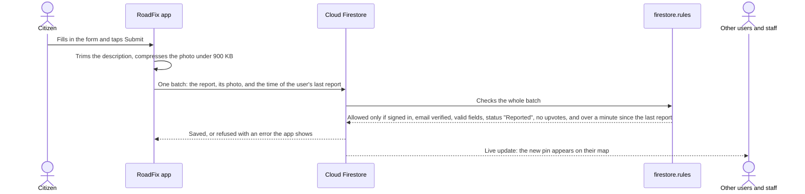

# RoadFix app plan

This document describes RoadFix as a whole: what it does, who uses it, how it's built, how it's kept secure and tested, and what comes next. Details live in the code, in [`docs/ci.md`](ci.md), in the [releases](https://github.com/lbrty-7/RoadFix/releases) and in the [issues](https://github.com/lbrty-7/RoadFix/issues).

## 1. About the app

RoadFix is an iPhone app for reporting road problems in the city: potholes, broken streetlights, damaged sidewalks and faded road markings. A resident takes a photo, pins the spot on the map and sends the report. City staff see every report, change its status as they fix it, and can leave a note that the resident sees.

**The problem it solves:** residents often don't know where to report a road problem, and they never hear back. Staff get the same problem reported many times, with no exact location. RoadFix gives both sides one shared map: every report has a photo, an exact location and a status, and duplicates are caught before they're sent.

## 2. Users and roles

| | Citizen | Staff |
|---|---|---|
| Sign up | With email and password | With email, password and the staff invite code |
| See reports on the map | Yes | Yes |
| File a report | Yes, once the email is verified, at most one per minute | Yes, same rules |
| Upvote a report | Once per report | Once per report |
| Edit or withdraw a report | Only their own, while it's still "Reported" | — |
| Change a report's status | No | Yes: Reported → In Progress → Resolved |
| Write a public note on a report | No | Yes |
| Delete any report | No | Yes, from the Staff Dashboard |
| Staff Dashboard tab | Hidden | Shown |

The staff invite code is checked by the Firestore rules on the server, not in the app, so a modified app can't make itself staff. The role is stored in the user's profile and can't be changed afterwards.

## 3. Features

### Done

**Accounts**
- Sign up, log in, log out, forgot password (reset email), change password
- Email verification, with buttons to send the email again and to check it
- Password rules: at least 12 characters, not a common password, not containing the email
- Sign-up requires being 16 or older and accepting the Terms of Use and Privacy Policy, which are also in Settings
- Delete account: removes the login, the profile, the user's reports and photos, and their upvotes on other reports

**Reports**
- New report: category, description, optional photo (camera or library), location from GPS or a tap on the map, street address looked up automatically
- Warning about open reports of the same category within 50 m, with an option to upvote one instead
- Map with pins, status and category filters (resolved reports hidden by default) and a locate-me button
- Report detail: photo, address, upvotes, staff note and a status history timeline
- My Reports: every report the user filed, with an "Updated" marker and a tab badge when staff change a status
- Edit or withdraw your own report while it's still "Reported"

**Staff**
- Staff Dashboard: search, sort (newest, oldest, most upvoted), status filter, photo thumbnails, swipe to delete
- Change a report's status and write a public note

**Across the app**
- English, Romanian and Russian
- Crash and error monitoring with Sentry, without personal data
- Privacy manifest (`PrivacyInfo.xcprivacy`)
- Unit tests and a CI pipeline on every pull request

### In progress and planned

See the [roadmap](#8-roadmap-by-package) below: every open issue is in one of five packages.

## 4. Architecture

### Technologies

| Part | Technology |
|---|---|
| App | Swift and SwiftUI, iOS 26.2 or later, built with Xcode 27.2 |
| Login | Firebase Authentication (email and password) |
| Data | Cloud Firestore, with security rules in [`firestore.rules`](../firestore.rules) |
| Map and addresses | MapKit and Core Location |
| Crash reports | Sentry (`sentry-cocoa`) |
| Tests | Swift Testing |
| CI | GitHub Actions ([`ci.yml`](../.github/workflows/ci.yml)) |
| Packages | Swift Package Manager (Firebase, Sentry) |

### Folders

| Folder | What's in it |
|---|---|
| `RoadFix/RoadFixApp.swift`, `RootView.swift` | Where the app starts: sets up Sentry and Firebase, then shows the login screen or the main tabs |
| `RoadFix/Models/` | Plain Swift types with no UI: `Report`, `AppUser`, `PasswordPolicy`, plus finding duplicates, searching and sorting |
| `RoadFix/Services/` | Talking to the outside world: `ReportService` (Firestore reads and writes), `LocationManager` (GPS), `CrashReporting` (Sentry) |
| `RoadFix/Auth/` | Login, sign-up and forgot-password screens, and `AuthViewModel` (accounts) |
| `RoadFix/Views/` | Every other screen: map, new report, report detail, My Reports, Staff Dashboard, Settings, legal documents |
| `RoadFixTests/` | Unit tests |
| `ci/` | Scripts used by the CI pipeline |
| `docs/` | Documentation |

To read the code, start at `RoadFixApp.swift`, then `RootView.swift`, then `Views/ContentView.swift` (the tabs).

### How a report travels

The app keeps a live connection (a Firestore *listener*) to the newest 500 reports for the map and dashboard, and a second one to all of the user's own reports for My Reports. Any change by anyone shows up on every phone within a second or two, without refreshing.

### Data in Firestore

| Collection | One document per | Fields |
|---|---|---|
| `users` | Account | `email`, `role` (`citizen` or `staff`), `createdAt`, `termsAcceptedAt`, `lastReportAt`, `staffCode` (staff only) |
| `reports` | Report | `category`, `description`, `latitude`, `longitude`, `address`, `status`, `upvoterIds`, `reporterId`, `hasPhoto`, `createdAt`, `staffNote`, `statusHistory` |
| `reportPhotos` | Report with a photo | `data`: the JPEG, under 900 KB (same ID as its report) |
| `config` | Setting | `staffInviteCode`: the staff code; the app can never read it |

Photos are kept apart from reports so the live map doesn't download every photo; a photo is loaded only when a report is opened.

## 5. Security and privacy

**Firestore rules** ([`firestore.rules`](../firestore.rules)) are the real protection: they run on Google's servers, so they apply even to someone who bypasses the app.
- Only signed-in users can read anything. Users can read only their own profile.
- A new report must come from a verified email, have valid fields, start as "Reported" with no upvotes, and be at least a minute after the user's previous report.
- Lists of reports are capped at 500 per request, so the whole collection can't be downloaded at once. Users can always list all of their own reports.
- A citizen can change only their own report, only its category and description, and only while it's "Reported". Anyone can add or remove only their own upvote.
- Only staff can change status and notes, or delete other people's reports.
- The staff code can't be read by any client.

**Personal data**
- The app stores the email, the reports and their photos and locations. Users can delete all of it from Settings.
- Sentry receives crashes and unexpected errors only: no email, no IP address, no screenshots (`sendDefaultPii` is off). Expected errors, such as a wrong password or no internet, aren't sent.
- The Privacy Policy (in the app, in all three languages) lists all of this.

**Private configuration**
- The Firebase config (`GoogleService-Info.plist`) and the Sentry DSN (`Sentry-Info.plist`) are not in git; the repo is public. CI fails if either one is committed.
- CI uses fake Firebase values and no Sentry DSN, so tests never touch real data.

## 6. Quality

**Tests:** 22 unit tests in 7 groups, run on every pull request:
- reading reports from Firestore data, including older reports and broken documents
- trimming report descriptions
- photo compression under the size limit
- duplicate detection
- dashboard sorting and search
- password and email rules
- which errors are sent to Sentry

**CI pipeline:** on every pull request and every push to `main`, GitHub Actions checks that no private config is committed, builds the app and runs every test. A failure turns the pull request red. Details in [`docs/ci.md`](ci.md).

**GitHub workflow**
1. Every change starts from an issue.
2. The work is done on its own branch.
3. A pull request links the issue (`Closes #N`), and CI must pass.
4. After review, it's merged into `main`, and the issue closes itself.

Commits are signed, so GitHub shows them as **Verified**.

## 7. Versions and releases

RoadFix follows [Semantic Versioning](https://semver.org): `MAJOR.MINOR.PATCH`.
- **MINOR** (0.5.0 → 0.6.0): new features
- **PATCH** (0.6.0 → 0.6.1): bug fixes only
- **MAJOR** (→ 1.0.0): the final, stable hand-in

Versions start at 0.x because the app is still in development and hasn't been published.

### Releases so far

| Version | Date | Contents |
|---|---|---|
| [v0.1.0](https://github.com/lbrty-7/RoadFix/releases/tag/v0.1.0) | 29 Sep 2026 | First working version: accounts, reports, map, upvotes, Staff Dashboard |
| [v0.2.0](https://github.com/lbrty-7/RoadFix/releases/tag/v0.2.0) | 30 Sep 2026 | Pin on the map, photos, street addresses, change password |
| [v0.3.0](https://github.com/lbrty-7/RoadFix/releases/tag/v0.3.0) | 1 Oct 2026 | Forgot password, delete account, duplicate warning, filters, staff notes, Romanian and Russian, unit tests |
| [v0.4.0](https://github.com/lbrty-7/RoadFix/releases/tag/v0.4.0) | 6 Nov 2026 | Terms and Privacy Policy, age and consent at sign-up, email verification, privacy manifest |
| [v0.5.0](https://github.com/lbrty-7/RoadFix/releases/tag/v0.5.0) | 16 Nov 2026 | Crash and error monitoring with Sentry |

v0.1.0 to v0.4.0 were tagged afterwards, on 16 November 2026, from the commits of those dates.

### Planned releases

| Version | Contents |
|---|---|
| v0.6.0 | CI pipeline, report fixes already on `main` (#20, #22, #24), automated releases (#13) |
| v0.7.0 | Firestore rules: package B |
| v0.8.0 | Accounts: package C |
| v0.9.0 | Reports and UX: the rest of package D |
| v1.0.0 | Monitoring and documentation (package E), protected `main` (#11): the final hand-in |

A bug fix found between these goes out as a PATCH, for example v0.6.1.

## 8. Roadmap by package

Every issue is in the [Internship evaluation](https://github.com/lbrty-7/RoadFix/milestone/1) milestone and has one package label. Status as of 20 November 2026.

### A. CI/CD (2 of 4 done)
- [x] [#3](https://github.com/lbrty-7/RoadFix/issues/3) CI pipeline: build and run tests on every pull request
- [x] [#4](https://github.com/lbrty-7/RoadFix/issues/4) Firebase and Sentry config for CI
- [ ] [#11](https://github.com/lbrty-7/RoadFix/issues/11) Protect the `main` branch and add a pull request template
- [ ] [#13](https://github.com/lbrty-7/RoadFix/issues/13) Versioning, CHANGELOG and automated releases

### B. Firestore rules (0 of 5 done)
- [ ] [#6](https://github.com/lbrty-7/RoadFix/issues/6) Integration tests for the security rules
- [ ] [#14](https://github.com/lbrty-7/RoadFix/issues/14) Staff can change any field of a report
- [ ] [#15](https://github.com/lbrty-7/RoadFix/issues/15) The one-report-per-minute limit can be bypassed by recreating the profile
- [ ] [#16](https://github.com/lbrty-7/RoadFix/issues/16) A photo can be attached to a report after it was created
- [ ] [#23](https://github.com/lbrty-7/RoadFix/issues/23) Reporters can upvote their own reports

### C. Accounts (0 of 4 done)
- [ ] [#5](https://github.com/lbrty-7/RoadFix/issues/5) Separate development and production configuration
- [ ] [#18](https://github.com/lbrty-7/RoadFix/issues/18) A wrong staff code silently creates a citizen account
- [ ] [#19](https://github.com/lbrty-7/RoadFix/issues/19) The login error still shows on the Create Account screen
- [ ] [#21](https://github.com/lbrty-7/RoadFix/issues/21) Login, Create Account and Settings texts aren't translated

### D. Reports (3 of 6 done)
- [ ] [#7](https://github.com/lbrty-7/RoadFix/issues/7) More unit tests for account and report logic
- [ ] [#17](https://github.com/lbrty-7/RoadFix/issues/17) New Report stays on "Submitting…" with no feedback when offline
- [x] [#20](https://github.com/lbrty-7/RoadFix/issues/20) Report description saved with spaces around it
- [x] [#22](https://github.com/lbrty-7/RoadFix/issues/22) A deleted account's upvotes stay on other reports
- [x] [#24](https://github.com/lbrty-7/RoadFix/issues/24) My Reports misses older reports
- [ ] [#25](https://github.com/lbrty-7/RoadFix/issues/25) UX improvements found while testing

### E. Monitoring and documentation (0 of 5 done)
- [ ] [#8](https://github.com/lbrty-7/RoadFix/issues/8) Replace `print` with structured logging
- [ ] [#9](https://github.com/lbrty-7/RoadFix/issues/9) Show the exact location and cause of errors in Sentry
- [ ] [#10](https://github.com/lbrty-7/RoadFix/issues/10) Investigate the app hang at launch reported by Sentry
- [ ] [#12](https://github.com/lbrty-7/RoadFix/issues/12) README with setup, tests, CI/CD and architecture
- [ ] [#29](https://github.com/lbrty-7/RoadFix/issues/29) This app plan

**Suggested order:** B first, because those are security holes in data that's already live. Then C and D (bugs users see), then the rest of A (release automation before v1.0.0), and E last, so the documentation describes the final app.

## 9. Risks and limitations

| Risk | Effect | What we do about it |
|---|---|---|
| No paid Apple Developer account | The app can't go on TestFlight or the App Store; it runs only from Xcode, on a simulator or a team member's iPhone | Releases are published on GitHub; the demo runs from Xcode |
| Firebase free tier | Daily limits on reads, writes and storage | Photos are compressed under 900 KB, and lists are capped at 500 reports |
| One Firebase project for development and real use | Testing can touch real data | #5 separates the two; CI already uses fake values |
| Rule holes found in testing (#14, #15, #16, #23) | A user who bypasses the app could change or fake some data | Package B fixes them, with tests (#6) |
| Firebase API key in the public history | The key was in git until 16 November 2026 | It's no longer tracked. The key only identifies the project, and the rules protect the data. The repository owner should also restrict the key in Google Cloud Console |
| The CI runners for Xcode 27 are still in preview | Runs can be slower some days (7 to 20 minutes) | Swift packages are cached; see [`docs/ci.md`](ci.md) |
| Only Firebase-free logic has unit tests | Firestore and login code is tested by hand | #6 and #7 add tests against the Firebase emulator |
